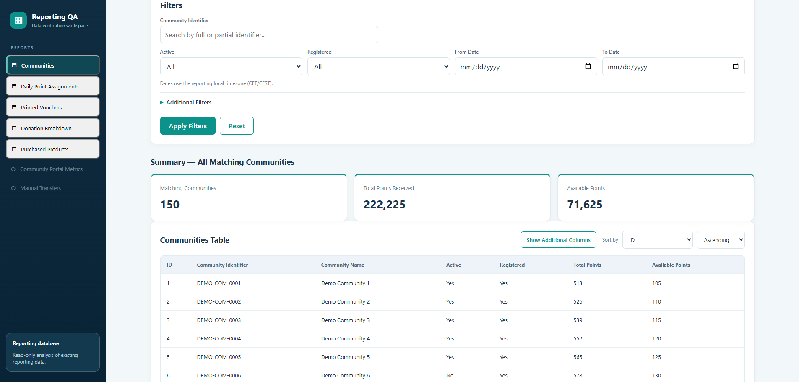
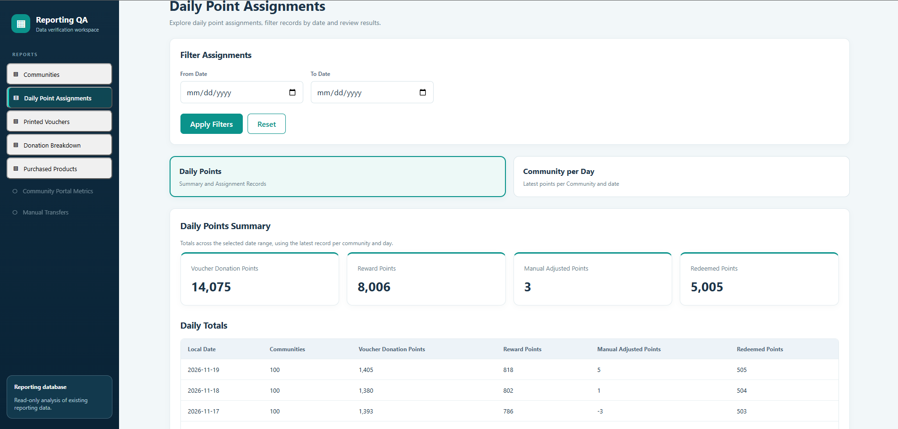
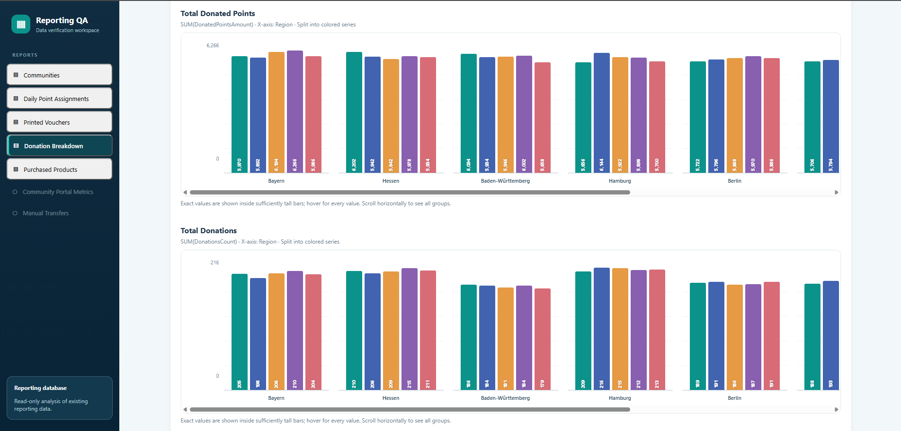
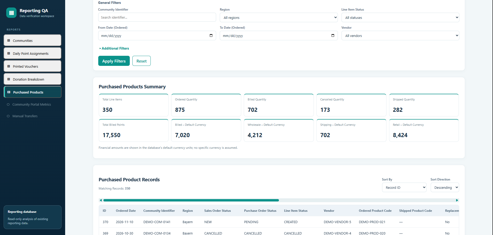
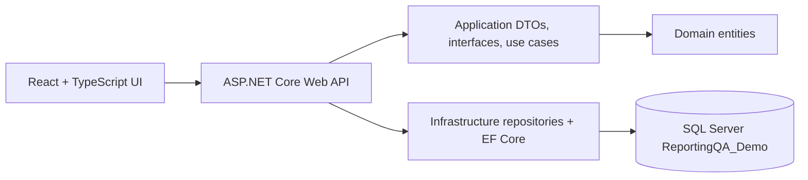

# Reporting QA Dashboard

**A full-stack reporting verification application built with ASP.NET Core, React, TypeScript, and SQL Server.**

Reporting QA Dashboard is a read-only data exploration tool developed during a software development internship. It helps reviewers inspect detailed reporting records, apply consistent filters, and validate database-level aggregates against figures shown in Power BI reports.

This portfolio edition runs against a **fully synthetic SQL Server LocalDB database**. It does not include company data, a production database export, or credentials.

## At a glance

- **Backend:** C#, ASP.NET Core (.NET 10), Entity Framework Core, SQL Server
- **Frontend:** React, TypeScript, Vite, CSS
- **Architecture:** API → Application → Domain, with Infrastructure implementing data-access contracts
- **Verification:** Swagger/OpenAPI, SSMS, SQL checks, browser testing
- **Core capabilities:** advanced filtering, server-side sorting and pagination, full-filter summaries, and comparison charts

## Screenshots

Screenshots below use synthetic demo records, not real reporting data.

### Communities



### Daily Point Assignments



### Donation Breakdown — Records


### Donation Breakdown — Compare & Charts



### Purchased Products



## Features

| Module                      | Capabilities                                                                                                                                         |
| --------------------------- | ---------------------------------------------------------------------------------------------------------------------------------------------------- |
| **Communities**             | Search, registration/activity filters, sorting, pagination, and summary totals.                                                                      |
| **Daily Point Assignments** | Reporting-date filtering, per-day summaries, per-community/day results, and deterministic selection of the latest record.                            |
| **Printed Voucher Tags**    | Browsable records, tag-based filtering, and aggregated summaries.                                                                                    |
| **Donation Breakdown**      | Region, voucher-tag and donated-period multiselect filters; synchronized Records and Summary; pagination; two comparison charts and grouped results. |
| **Purchased Products**      | Line-item reporting, multiple status/product/vendor filters, quantity and financial summaries, and latest-record handling.                           |

**Comparison workflow:** start with the filters applied in Donation Breakdown Records, choose a grouping dimension (region, voucher tag, or donated period), then view **SUM of donated points** and **SUM of donation counts**. An optional second comparison dimension splits groups into chart series. An optional minimum-group-total filter can narrow the displayed results.

**Summary rule:** reporting totals are calculated over **all matching records** by the backend, not just the visible page. Sorting and pagination do not change those totals.

## Development workflow & AI-assisted tools

AI-assisted coding tools were used to support implementation, debugging, and documentation. The application was tested and validated through .NET and frontend builds, SQL checks in SSMS, Swagger endpoint tests, and manual UI verification. The focus was on understanding the implementation, verifying results, and applying mentor feedback.

## Architecture



The application follows a layered, Clean Architecture-inspired design:

```text
ReportingQA-Dashboard/
├── ReportingQA.API/              # Controllers, API startup and configuration
├── ReportingQA.Application/      # DTOs, interfaces and use cases
├── ReportingQA.Domain/           # Reporting domain entities
├── ReportingQA.Infrastructure/   # EF Core DbContext and SQL repositories
├── ReportingQA.API.slnx          # .NET solution
├── frontend/                     # React + TypeScript application
├── database/
│   ├── schema.sql                # Creates the local demo database and tables
│   ├── seed-demo.sql             # Inserts synthetic demo records
│   ├── verify-demo.sql           # Verifies row counts and reporting rules
│   └── README-demo.md            # Additional database setup notes
├── screenshots/                  # Images taken using synthetic demo data
└── README.md
```

The frontend talks only to the API; database access and the connection string stay on the backend. The reporting endpoints are designed for reading and validating data, not editing the reporting database.

## Run locally (Windows + SQL Server LocalDB)

### Prerequisites

- [.NET 10 SDK](https://dotnet.microsoft.com/download/dotnet/10.0)
- A recent Node.js version compatible with the Vite version in `frontend/package.json`, plus npm
- SQL Server **LocalDB** (`MSSQLLocalDB` instance)
- SQL Server Management Studio (SSMS) or another SQL client that supports SQL Server scripts

### 1. Clone the repository

```powershell
git clone https://github.com/rijadb/ReportingQA-Dashboard.git
cd ReportingQA-Dashboard
```

### 2. Create and seed the synthetic database

1. Open SSMS and connect to **`(localdb)\MSSQLLocalDB`** with **Windows Authentication**.
2. Run `database/schema.sql` in a new query window.
3. Run `database/seed-demo.sql` in a new query window.
4. Run `database/verify-demo.sql` and confirm that the checks pass.

All scripts target **`ReportingQA_Demo` on SQL Server LocalDB** and include guards against execution on a non-LocalDB server. `seed-demo.sql` is intended to be run only once; it refuses to insert a second copy of the data.

For more detail, see [database/README-demo.md](database/README-demo.md).

### 3. Configure the backend connection

From the repository root, store the demo connection string with **ASP.NET Core User Secrets**:

```powershell
dotnet user-secrets set "ConnectionStrings:ReportingDb" "Server=(localdb)\MSSQLLocalDB;Database=ReportingQA_Demo;Trusted_Connection=True;TrustServerCertificate=True;" --project .\ReportingQA.API\ReportingQA.API.csproj
```

The backend reads the configuration key `ConnectionStrings:ReportingDb`. The value above uses local Windows Authentication and contains no password. **Do not commit credentials or machine-specific secrets** to the repository.

### 4. Build and run the backend

```powershell
dotnet restore .\ReportingQA.API.slnx
dotnet build .\ReportingQA.API.slnx
dotnet run --project .\ReportingQA.API\ReportingQA.API.csproj --launch-profile http
```

The `http` development launch profile uses **http://localhost:5066**. Open Swagger at:

**http://localhost:5066/swagger**

Keep this terminal running while testing the frontend.

### 5. Run the frontend

Open a **second terminal** from the repository root:

```powershell
cd frontend
npm ci
npm run dev
```

Open the URL displayed by Vite (typically **http://localhost:5173**). The Vite development proxy forwards `/api` requests to **http://localhost:5066**.

If you change the API port, update the proxy target in `frontend/vite.config.js` accordingly.

## Demo data and expected verification results

The demo uses fictional `DEMO-...` community identifiers, synthetic quantities, and representative reporting categories. It is intentionally small enough to run on a personal computer while still exercising filtering, pagination, aggregation, and duplicate-record rules.

| SQL table                        | Raw demo rows | Notes                                                            |
| -------------------------------- | ------------: | ---------------------------------------------------------------- |
| `Communities`                    |           150 | Synthetic community profiles and regions                         |
| `CommunityDailyPointAssignments` |         1,035 | 1,000 effective community/date records after latest-ID selection |
| `PrintedVoucherTags`             |           200 | Synthetic voucher-tag records                                    |
| `DonationsBreakdown`             |         2,000 | Multiple regions, voucher tags and donated periods               |
| `PurchasedProducts`              |           370 | 350 effective line items after latest-ID selection               |

After successful setup, the unfiltered **Donation Breakdown Summary** should return:

```json
{
  "totalRecords": 2000,
  "totalDonations": 6998,
  "totalDonatedPoints": 208180
}
```

Example API requests:

```text
GET /api/communities
GET /api/communities/summary
GET /api/community-daily-point-assignments/daily-summary
GET /api/printed-voucher-tags/summary
GET /api/donation-breakdown/multi
GET /api/donation-breakdown/multi/summary
GET /api/donation-breakdown/comparison
GET /api/purchased-products/summary
```

The verification script checks physical row counts, the latest-ID deduplication results, and key donation aggregates. For a fuller QA pass, also test the filters and totals in Swagger and compare them with the dashboard.

## Development and quality checks

**Backend**

```powershell
dotnet build .\ReportingQA.API.slnx
```

**Frontend** (from `frontend/`)

```powershell
npm run build
npm run lint
```

During development, the application was tested using SQL queries in SSMS, Swagger endpoints, and the React UI. A slow multiselect reporting path was optimized by reducing unnecessary SQL processing, improving observed local endpoint response times from roughly **20 seconds to under one second** in one test scenario. These are development measurements, not production benchmarks.

## Project background and scope

This project was developed during a software development internship to support **reporting QA**: investigating records and checking SQL-derived totals alongside BI reports. The public demo has been separated from the original data source and is designed to be reproducible without access to any company systems.

The repository is an **educational/portfolio demonstration**, not a production deployment. Production use would require organization-approved authentication/authorization, deployment configuration, and security review. The local SQL scripts are for demo setup only.

**Demo data only · No production credentials · Read-only reporting workflows**
